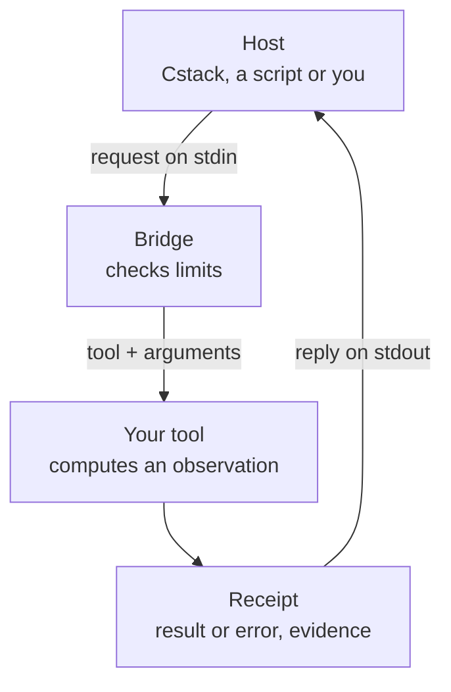

<p align="center"></p>

# foundation-template

A Foundation is a small program that checks other programs' results in one
subject and reports what it found, without changing anything. This is the
smallest working one: copy it to build your own, with the protocol, receipts,
tests and documentation already in place.

[](https://github.com/Akilleez-QA/foundation-template/actions/workflows/ci.yml) 

**Starting a new Foundation?** Go straight to [Start a new Foundation](#start-a-new-foundation).

## What a Foundation is

A Foundation is a read-only checker for one subject, such as maths, refrigeration
or film. Another program, the producer (a person, a script or an AI agent), makes
a result. The Foundation examines it and returns an observation with the evidence
behind it. It never changes anything and never controls equipment. The final
decision stays with a person or with the program that called it. Producers don't
grade their own work; a separate Foundation does. Because the checker is its own
process, the code that made a result isn't also the code that judges it. Standalone,
you get that separation, the receipt and the read-only boundary; proof that the
checker's files are unchanged comes from comparing them with `SOURCE-MANIFEST.json`,
which Cstack does automatically.

A Foundation runs on its own: any program that writes requests to its stdin can
use it, for example a CI job with a small wrapper you write that turns a
producer's output into `tools/call` lines and fails on a tool error. [Cstack](https://github.com/Akilleez-QA/cstack) is a host
program built around Foundations. It keeps a copy of each one with every file's
hash pinned, and its adapter refuses to start a Foundation whose files no longer
match, so nobody can quietly change the checker.

A check takes one of two shapes: a verdict on a result you pass in, or an
independent reference value that the caller compares with the producer's. For the
second kind, look at
[foundation-refrigeration](https://github.com/Akilleez-QA/foundation-refrigeration):
its `saturation_pressure` tool takes a refrigerant name and a temperature with a
unit, and returns the saturation pressure with evidence naming the property table
it was read from and the unit standard it cites, so a producer's figure can be
checked against it. The work is always passed inline
as JSON arguments; a Foundation never reads files or the network on the caller's
behalf.

## Why use this template

Every Foundation needs the same plumbing before it can check anything: a way for
the host to call it, limits on what it will read, a receipt format that says what
was checked, tests for all of that, and a documentation set. This repository has
all of it working around one placeholder tool. You replace the placeholder with
your own checks and keep the rest. It is standard-library Python with nothing to
install, licensed GPL-3.0-only, and copies inherit that license (see [License](#license)).

## How it works



The bridge (`foundation_template_bridge/`) reads one request per line, rejects
anything too large or too deeply nested, and requires `initialize` before any tool
call. Then it calls a tool function in `foundation_template/tools.py`. Every reply
carries a receipt: the result or the error, the evidence behind it, a SHA-256 hash
of the exact arguments, and a `boundary` block stating that this is an observation
only, not a determination or a control action. A bad argument still gets a
receipt, marked as a tool error. Around the receipt, `assessment` names the
outcome, and `formal_proof` and `runtime_goal_acceptance` are always `false`,
stating outright that a receipt is never a proof or an acceptance.

Two deliberate defaults:

- **Integers only.** Every JSON number must be a whole number of at most 15
  digits. It is the smallest safe default; a copy that needs decimals adds a
  bounded decimal parser, as foundation-refrigeration did.
- **Not MCP.** The method names (`tools/list`, `tools/call`) look like MCP, but
  the protocol is `foundation-template-jsonrpc/1`: smaller, with fixed limits, and
  `initialize` must name that exact version.

Each evidence entry says where a value came from (`basis.kind`; here `practice`,
the tool's own rule rather than a cited source) and its review state (`status`;
here `CHECK`, recorded but not approved by a qualified person).

## Example

The template's one tool, `echo_observation`, is a placeholder: it only checks that
its argument is a string of 1 to 256 characters and hands it back. Your tools do
the real checking. Here is a real session: initialize, one good call, one bad call.
Run it from the repository root:

```sh
printf '%s\n' \
  '{"jsonrpc":"2.0","id":1,"method":"initialize","params":{"protocolVersion":"foundation-template-jsonrpc/1"}}' \
  '{"jsonrpc":"2.0","id":2,"method":"tools/call","params":{"name":"echo_observation","arguments":{"observation":"reading 7"}}}' \
  '{"jsonrpc":"2.0","id":3,"method":"tools/call","params":{"name":"echo_observation","arguments":{"observation":""}}}' \
  | python3 -B -m foundation_template_bridge
```

The bridge writes one line per reply. Here is the good call's reply,
pretty-printed with keys reordered:

```json
{
  "id": 2,
  "jsonrpc": "2.0",
  "result": {
    "isError": false,
    "structuredContent": {
      "tool": "echo_observation",
      "assessment": "observation_echoed",
      "formal_proof": false,
      "runtime_goal_acceptance": false,
      "receipt": {
        "status": "ok",
        "tool": "echo_observation",
        "version": "0.1.0",
        "result": {"observation": "reading 7"},
        "error": null,
        "evidence": [{"applies_to": "result.observation",
                      "evidence": {"basis": {"kind": "practice", "note": "Placeholder echo of the caller's own input; no domain source backs it."},
                                   "status": "CHECK"}}],
        "input_sha256": "390b41208788ba1a60e380839cbbef164c0d5cf34e0b3b3857c659d9a0f4e1e6",
        "boundary": {"control_action": false, "domain_determination": false, "observation_only": true}
      }
    }
  }
}
```

The bad call (an empty string) comes back with `"isError": true`, a receipt with
`"result": null` and `"error": "observation must be a string of 1 to 256 characters"`,
and its own evidence entry saying which check refused it. The first reply, to
`initialize`, lists the bridge's limits and methods. The bridge exits 0 when stdin
closes. The [first-session tutorial](docs/guides/tutorials/first-bridge-session.md)
walks through this step by step.

## Install and run

You need Python 3.11 or newer as `python3` (CI uses 3.12). Nothing is installed.
`-B` stops Python writing `.pyc` cache files into the tree.

```sh
git clone https://github.com/Akilleez-QA/foundation-template
cd foundation-template
python3 -B -m unittest discover -s tests -t .
python3 -B tools/build_manifest.py
```

The tests end with `OK`. `build_manifest.py` rewrites `SOURCE-MANIFEST.json` (a
SHA-256 for every shipped file) and prints the file count, the manifest hash and
the tool-inventory hash; on a clean checkout the file comes out unchanged.

## Start a new Foundation

The full walk-through is [Start a new Foundation](docs/guides/how-to/start-a-new-foundation.md).
In short, for a Foundation called `foundation-acoustics`:

1. **Copy and rename.** Start a fresh history and replace the template's name
   everywhere:

   ```sh
   git clone https://github.com/Akilleez-QA/foundation-template foundation-acoustics
   cd foundation-acoustics
   rm -rf .git && git init
   mv foundation_template foundation_acoustics
   mv foundation_template_bridge foundation_acoustics_bridge
   grep -rlI --exclude-dir=.git -e foundation_template -e foundation-template . \
     | xargs sed -i -e 's/foundation_template/foundation_acoustics/g' -e 's/foundation-template/foundation-acoustics/g'
   ```

   The rename also changes GitHub links and the CI badge to your new repository
   name. It also rewrites this template's own row in the Related projects table
   of `README.md`; change that row back to `foundation-template`.

2. **Replace the placeholder tool.** Write your checks in
   `foundation_acoustics/tools.py` (the tool functions; the top-level `tools/`
   folder holds build scripts), give each a closed input and output schema in
   `foundation_acoustics_bridge/schemas.py`, and replace the placeholder tests.
   Keep `run()`, the receipt shape, the bridge and the input-limit tests.
3. **Adapt the documentation.** Every document in `docs/` is a filled-in example
   for the template. Edit each one for your subject (the guide has a table of what
   to change in each file). Rename the ID prefixes to your own: `FTEMPLATE` on
   document IDs, `REQ-TPL` on requirements and `GAP-TPL` on known untested gaps.
4. **Generate and check.** Regenerate the tool catalog and `SOURCE-MANIFEST.json`,
   then run the trace check and both test modes (`-O` repeats the tests with
   assertions stripped, as CI does). The trace check confirms that
   every requirement has a test, every test has a requirement and every link
   works; repeat until it prints `0 problem(s)`:

   ```sh
   python3 -B tools/gen_docs.py
   python3 -B tools/build_manifest.py
   python3 -B tools/check_trace.py
   python3 -B -m unittest discover -s tests -t .
   python3 -B -O -m unittest discover -s tests -t .
   ```

5. **Connect it to a host.** Any program can drive the bridge directly. To run
   it under Cstack, open a pull request on the Cstack repository that vendors a
   copy of your repository, adds an adapter beside the existing ones in its
   `adapters/` folder, and records the three values `build_manifest.py` prints in
   its `contracts/SOURCE-PINS.json`: `files` (the file count), `sha256` (the
   manifest hash) and `inventory_sha256` (the tool-inventory hash).

### What a copy inherits

| Part | What you get | What you change |
|---|---|---|
| `foundation_template_bridge/` | stdio JSON-RPC bridge with input limits and error codes | The package name; the numeric profile only if you need decimals |
| `foundation_template/tools.py` | `run()`, receipt shape, Evidence entries, input hash | The tools themselves |
| `tests/` | Bridge, input-limit, manifest and documentation-trace tests | The placeholder tool tests |
| `tools/` | Manifest builder, trace check, catalog and report generators | A few constants (prefix, names) |
| `docs/` | Tutorial, how-to, reference, explanation, and a full set of engineering records | Every document, for your subject |

## Limitations

- The only tool is a placeholder that echoes its input; it has no subject meaning.
- The numeric profile is integers only. A copy that needs decimals must add a
  bounded decimal parser (foundation-refrigeration has one), with requirements and tests.
- Several bridge error paths have no test, and copies inherit those gaps
  ([list](docs/requirements/requirements.md#9-untested-behaviour-gaps)).
- Version 0.1.0, not yet released or tagged.

Details: [Limitations](docs/guides/explanation/limitations.md).

## Where to go next

- [Tutorial: your first bridge session](docs/guides/tutorials/first-bridge-session.md)
- [Start a new Foundation](docs/guides/how-to/start-a-new-foundation.md)
- [Tool catalog](docs/guides/reference/tool-catalog.md): every tool, argument and error code
- [Interface contract with Cstack](docs/icd/icd-cstack.md)
- [Documentation index](docs/README.md)

## Related projects

| Repository | Role |
|---|---|
| [Cstack](https://github.com/Akilleez-QA/cstack) | Host; runs Foundations from byte-pinned copies |
| [EndoForge](https://github.com/Akilleez-QA/endoforge) | Research engine that turns short needs into checked WebAssembly kernels |
| [POODO](https://github.com/Akilleez-QA/poodo) | Reasoning skill that shows evidence before it acts |
| [foundation-engine](https://github.com/Akilleez-QA/foundation-engine) | Browser games framework; Cstack uses its two read-only validators as a Foundation |
| [foundation-math](https://github.com/Akilleez-QA/foundation-math) | Exact checks of mathematical claims and certificates |
| [foundation-film](https://github.com/Akilleez-QA/foundation-film) | Film-production acceptance checks |
| [foundation-refrigeration](https://github.com/Akilleez-QA/foundation-refrigeration) | Refrigeration data and checks |
| [foundation-robotics](https://github.com/Akilleez-QA/foundation-robotics) | Physics checks for motion |
| foundation-template (this repository) | Minimal Foundation to copy for a new subject |

## Layout

| Path | Contents |
|---|---|
| `foundation_template/` | Tool functions and receipts |
| `foundation_template_bridge/` | stdio JSON-RPC bridge and schemas |
| `tests/` | Unit, bridge, input-limit and documentation-trace tests |
| `tools/` | Manifest builder, trace check, documentation and report generators |
| `docs/` | Guides and engineering records |
| `SOURCE-MANIFEST.json` | SHA-256 of every shipped file outside `.github/` |

## Contributing

See [CONTRIBUTING.md](CONTRIBUTING.md) and [SECURITY.md](SECURITY.md).

## Engineering records

The documentation set follows the Cstack family documentation standard, organised
after NASA software documentation guidance and tailored for a small open-source
project. Copies inherit it. Classification: self-assessed Class E analog, not
safety-critical; not a NASA compliance determination (see the
[software management plan](docs/plan/software-management-plan.md#1-software-classification-self-assessed)).

- [Software management plan](docs/plan/software-management-plan.md) and [compliance matrix](docs/plan/compliance-matrix.md)
- [Requirements](docs/requirements/requirements.md), [design](docs/architecture/architecture.md) and [data dictionary](docs/data/data-dictionary.md)
- [Test plan](docs/verification/test-plan.md), [verification matrix](docs/verification/verification-matrix.md) and the generated [test report](docs/verification/reports/STR-unreleased.md), which records the latest local run of the CI commands
- [Configuration management](docs/configuration/configuration-management.md), [version descriptions](docs/releases/README.md) and [assurance record](docs/assurance/assurance-record.md)
- [All control documents with IDs](docs/README.md#engineering-records)

CI runs the tests in normal and optimized mode on Python 3.12, scans the history
with gitleaks and checks that the source manifest is up to date.

## License

Copyright © 2026 Refrigeration.AI. Copies start from this code, so they carry the
same license unless you obtain a commercial one.


This project is available under the GNU General Public License v3.0 only (GPL-3.0-only). If you want to use it to create a product or service under different terms, commercial licenses are available from Refrigeration.AI. Contact craig@nh3.biz.
