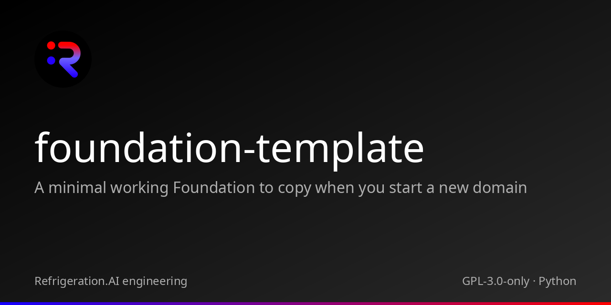

<p align="center"></p>

# foundation-template

A minimal working Foundation to copy when you start a new domain

[](https://github.com/Akilleez-QA/foundation-template/actions/workflows/ci.yml) 

## Status

Version 0.1.0, unreleased (no tags yet). One read-only placeholder tool behind a stdio JSON-RPC bridge, standard library only. Every result, including tool errors, carries Evidence and an input hash. A result is an observation, not an acceptance decision.

Classification: self-assessed Class E analog, not safety-critical; not a NASA compliance determination (see the [software management plan](docs/plan/software-management-plan.md#1-software-classification-self-assessed)). The documentation set is itself the template for a new Foundation's documentation: [Start a new Foundation](docs/guides/how-to/start-a-new-foundation.md).

## Quickstart

```sh
git clone https://github.com/Akilleez-QA/foundation-template
cd foundation-template
python -B -m unittest discover -s tests -t .
python -B tools/build_manifest.py
```

Requires Python 3.11 or newer; nothing is installed. The tests end with `OK`, and `build_manifest.py` prints the file count, manifest SHA-256 and inventory SHA-256 without changing a clean checkout. To talk to the bridge, follow the [first-session tutorial](docs/guides/tutorials/first-bridge-session.md).

## What is inside

| Tool | Purpose |
|---|---|
| `echo_observation` | PLACEHOLDER: returns its validated input as an observation with Evidence |

## Measured

The generated [test report](docs/verification/reports/STR-unreleased.md) records the latest local run of the CI commands for main: commit, Python version, per-test results in normal and optimized mode, the trace check and the secret scan. At commit `30c1287` on Linux x86_64 with CPython 3.12.14, `python -B -m unittest discover -s tests -t .` and the same with `-O` each ran 12 tests and passed.

CI runs both modes on Python 3.12, scans history with gitleaks and verifies the source manifest.

## Limitations

- The only tool is a placeholder that echoes its input; it has no domain meaning.
- The numeric profile is integers only.
- Several bridge error paths have no test; copies inherit them (see the [requirements](docs/requirements/requirements.md#9-untested-behaviour-gaps)).

Details: [Limitations](docs/guides/explanation/limitations.md).

## Documentation

Start at [docs/README.md](docs/README.md): a [tutorial](docs/guides/tutorials/first-bridge-session.md), [Start a new Foundation](docs/guides/how-to/start-a-new-foundation.md), the generated [tool catalog](docs/guides/reference/tool-catalog.md), and the control documents (plan, compliance matrix, requirements, design, interface, data dictionary, test plan, verification matrix, configuration management, assurance record). Copy them with the code.

## Related projects

| Repository | Role | Relation |
|---|---|---|
| [cstack](https://github.com/Akilleez-QA/cstack) | Runs Foundations behind pinned adapters under one human approver | Host |
| [foundation-engine](https://github.com/Akilleez-QA/foundation-engine) | TypeScript and three.js framework for browser games | Foundation |
| [foundation-math](https://github.com/Akilleez-QA/foundation-math) | Exact mathematical kernels and physics research tools | Foundation |
| [foundation-film](https://github.com/Akilleez-QA/foundation-film) | Film-production acceptance checks | Foundation |
| [foundation-refrigeration](https://github.com/Akilleez-QA/foundation-refrigeration) | Refrigeration data and checks | Foundation |
| [foundation-robotics](https://github.com/Akilleez-QA/foundation-robotics) | Physics checks for motion | Foundation |
| [foundation-template](https://github.com/Akilleez-QA/foundation-template) | Minimal Foundation to copy for a new domain | Foundation |
| [endoforge](https://github.com/Akilleez-QA/endoforge) | Workshop for running coding agents with checks and receipts | Tool |
| [poodo](https://github.com/Akilleez-QA/poodo) | Reasoning skill that shows evidence before it acts | Tool |

## Layout

| Path | Contents |
|---|---|
| `foundation_template/` | Domain package |
| `foundation_template_bridge/` | stdio JSON-RPC bridge and schemas |
| `tests/` | Unit and bridge tests |
| `tools/` | Manifest, trace-check and documentation generators |
| `docs/` | Plan, requirements, design, interface, data dictionary, verification, configuration, releases, assurance, guides |
| `SOURCE-MANIFEST.json` | SHA-256 of every shipped source file outside `.github/` |

## Contributing

See [CONTRIBUTING.md](CONTRIBUTING.md).

## Security

See [SECURITY.md](SECURITY.md).

## License

This project is available under the GNU General Public License v3.0 only (GPL-3.0-only). If you want to use it to create a product or service under different terms, commercial licenses are available from Refrigeration.AI. Contact craig@nh3.biz.
