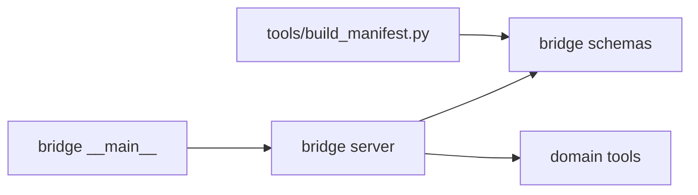
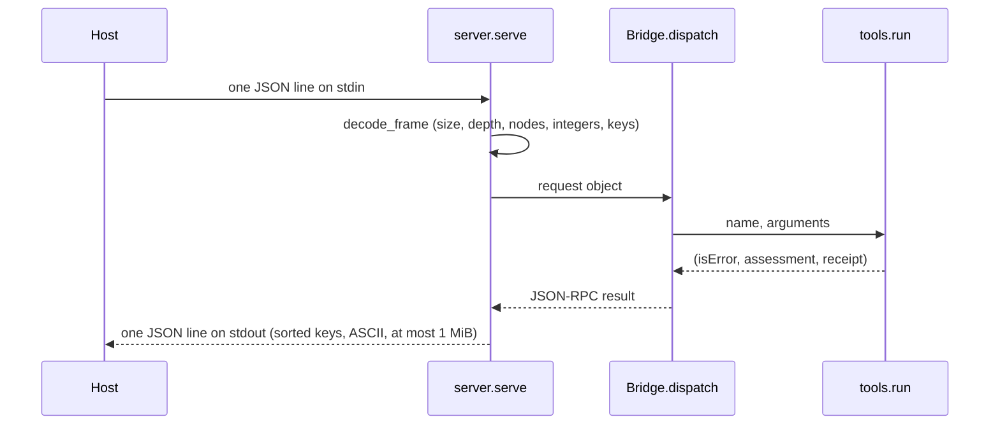

# foundation-template software design description

| Field | Value |
|---|---|
| Document ID | FTEMPLATE-SDD |
| Version | 2.1 |
| Status | Baselined |
| Owner | Akilleez-QA |
| Date | 2026-11-09 |
| Baseline commit | fb9993c55e9c708a3cfdd295b237466d4bef7ff1 |
| Applies to | foundation-template main at baseline commit |
| Classification | Self-assessed Class E analog; not safety-critical (see SMP §1) |

> Organized after [NPR 7150.2D](https://nodis3.gsfc.nasa.gov/displayAll.cfm?Internal_ID=N_PR_7150_002D_&page_name=all), [NASA-STD-8739.8B](https://standards.nasa.gov/standard/nasa/nasa-std-87398) and the [NASA Software Engineering Handbook](https://swehb.nasa.gov/display/SWEHBVD/7.18+-+Documentation+Guidance) documentation guidance. This is not a NASA compliance determination or certification. The software classification is a self-assessed analog (Class E, not safety-critical); no NASA authority, independent verification and validation, or hazard analysis is asserted. The document describes the implementation inspected at the baseline commit.

## 1. Purpose and design boundary

This document explains how foundation-template meets its [requirements](../requirements/requirements.md), and describes the skeleton every Foundation copied from it inherits. It is written for someone about to change the template or start a copy.

A Foundation owns the meaning, data and acceptance checks of one domain. POODO governs how it is used. The host (Cstack, through its stdio adapter) starts the bridge, pins its source and validates every result. The template is read-only with respect to the outside world: it reads JSON-RPC requests on stdin and writes responses on stdout. It reads no files, writes no files, opens no network connection and controls nothing.

## 2. Design decisions and trade-offs

| Decision | Alternatives considered | Rationale | Requirements |
|---|---|---|---|
| Read-only observations with a fixed `boundary` object | Pass/fail verdicts | A Foundation reports; acceptance belongs to a person or the host | REQ-TPL-003 |
| Evidence on every result, including tool errors | Evidence on success only (foundation-refrigeration's choice) | Even a refusal records which check refused it. A copy may choose either, but must state it in its SRS | REQ-TPL-004 |
| Python standard library only | Third-party packages | The whole source can be hashed and pinned; no install step | REQ-TPL-006 |
| Own line-delimited JSON-RPC bridge, explicitly not MCP | MCP server | A small, bounded protocol the host can verify byte for byte | REQ-TPL-007, REQ-TPL-008 |
| Integer-only numeric profile | Decimals | Smallest safe default; a copy that needs decimals adds a bounded decimal parser (see foundation-refrigeration) | REQ-TPL-010 |
| One placeholder tool | No tool | A copy sees the full path from schema to receipt and replaces it | REQ-TPL-001, REQ-TPL-012 |
| Source manifest of every shipped file, outside `.github/` | Pin a release archive | The host verifies the exact bytes it runs; CI-only changes need no repin | REQ-TPL-002 |

## 3. Architecture overview

## 4. Components

| Component | Path | Responsibility | Inputs → outputs | Requirements |
|---|---|---|---|---|
| Bridge entry point | `foundation_template_bridge/__main__.py` | Disables bytecode writing and starts `server.main` | argv → exit status | REQ-TPL-006, REQ-TPL-011 |
| Bridge server | `foundation_template_bridge/server.py` | Frame decoding and limits, JSON-RPC envelope, handshake, dispatch, response encoding, exit status | stdin lines → stdout lines | REQ-TPL-006, REQ-TPL-007, REQ-TPL-008, REQ-TPL-010, REQ-TPL-011 |
| Schemas | `foundation_template_bridge/schemas.py` | Tool inventory with closed input and output JSON Schemas | none → tool definitions | REQ-TPL-003, REQ-TPL-009 |
| Domain tools | `foundation_template/tools.py` | Argument checks, the tool itself, receipts (`input_sha256`, `boundary`, Evidence) | tool name and arguments → (isError, assessment, receipt) | REQ-TPL-001, REQ-TPL-003, REQ-TPL-004, REQ-TPL-005, REQ-TPL-009, REQ-TPL-012 |
| Manifest tool | `tools/build_manifest.py` | Writes `SOURCE-MANIFEST.json`; prints file count, manifest SHA-256 and inventory SHA-256; `--inventory` prints the canonical inventory | source tree → manifest | REQ-TPL-002 |
| Package version | `foundation_template/__init__.py` | Holds `__version__` | none → version string | Infrastructure |
| Documentation tools | `tools/check_trace.py`, `tools/gen_docs.py`, `tools/gen_reports.py` | Trace and link check; generated tool catalog; generated test report and version description, whose verdict fails on any failed or unrun gate, skip or unparsed outcome | docs, tests, schemas → checks and generated Markdown | REQ-TPL-013 |

## 5. Execution concept

- One process, one thread. `serve` reads one line at a time (at most 65 538 bytes per read), handles it and flushes the response before reading the next. No concurrency, batching or cancellation. Closing stdin ends the session with exit 0.
- State: only `Bridge.initialized`. Tool functions are pure over their arguments.
- Ordering: `initialize` once before `tools/list` or `tools/call`. `ping` works at any time. A request without `id` gets no response.
- Timeouts: none inside the bridge; the host sets its own.

## 6. Interfaces

- External: the stdio JSON-RPC bridge, in the [Cstack ICD](../icd/icd-cstack.md). The generated [tool catalog](../guides/reference/tool-catalog.md) lists every argument and error.
- Data: receipt and file formats in the [data dictionary](../data/data-dictionary.md).
- Internal: `tools.run(name, arguments)` returns `(isError, assessment, receipt)`. Tools raise `ToolInputError` for bad arguments.

## 7. Failure handling and containment

| Failure | Handling | Requirement |
|---|---|---|
| Malformed, oversized or non-integer frame | JSON-RPC error `-32700` or `-32002`; no tool runs | REQ-TPL-007, REQ-TPL-010 |
| Line over the frame limit | Error response, then exit 2 | REQ-TPL-011 |
| Call before `initialize`; unknown tool | `-32000`; `-32602` | REQ-TPL-008 |
| Bad tool arguments | Tool error result with Evidence | REQ-TPL-004, REQ-TPL-012 |
| Unexpected exception; oversized response | `-32603`; "Result withheld" (untested: GAP-TPL-002, GAP-TPL-003) | — |

Nothing is retried. Nothing is written, so nothing is quarantined.

## 8. Resource use

Input is bounded per frame (64 KiB, 4096 nodes); output per frame (1 MiB). No disk, network or child processes. No timing is measured or claimed.

## 9. Quality attributes

| Attribute | How the design supports it |
|---|---|
| Traceability | Evidence on every result; `input_sha256`; manifest and inventory digests |
| Security | Bounded parser; integer-only numbers; no paths, options, network or file access; closed schemas |
| Maintainability | Four small source files; rationale in `docs/`; generated reference page |
| Testability | The bridge can be driven in-process (`decode_frame`, `serve`) or as a real child process |
| Portability | Standard library only; tested in CI on Python 3.12 on Ubuntu |
| Reusability | Copy-ready layout and documentation set; see [Start a new Foundation](../guides/how-to/start-a-new-foundation.md) |

## 10. Assumptions and limitations

- The host validates each response against the pinned output schema; the bridge does not validate its own output.
- The placeholder tool has no domain meaning. See [Limitations](../guides/explanation/limitations.md).

## Change history

| Version | Date | Commit | Change | Reviewed in |
|---|---|---|---|---|
| 1.0 | 2026-10-30 | fbfaadb | Context, components, tools, data flow, decisions | Initial commit |
| 2.0 | 2026-11-08 | fb9993c | NASA-standard structure; components with requirement IDs; execution, failure and quality sections | PR adding the NASA-standard documentation set |
| 2.1 | 2026-11-09 | 3814683 | Documentation tools allocated REQ-TPL-013 | PR fixing the 2026-11-09 backfill-review findings |
